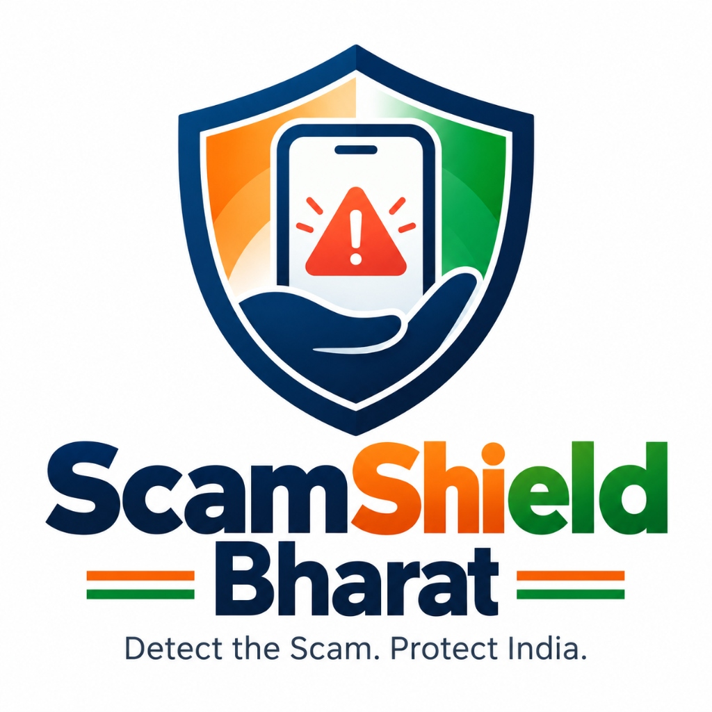
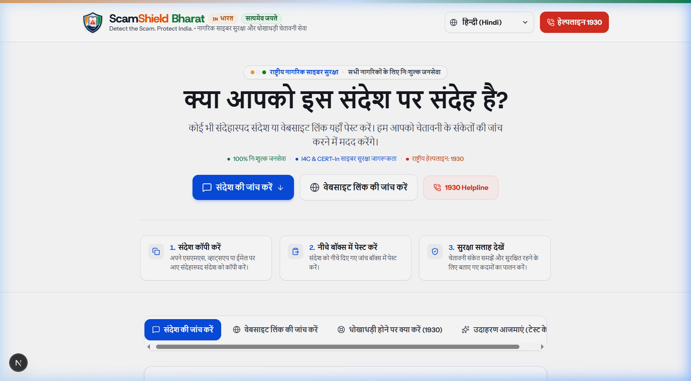
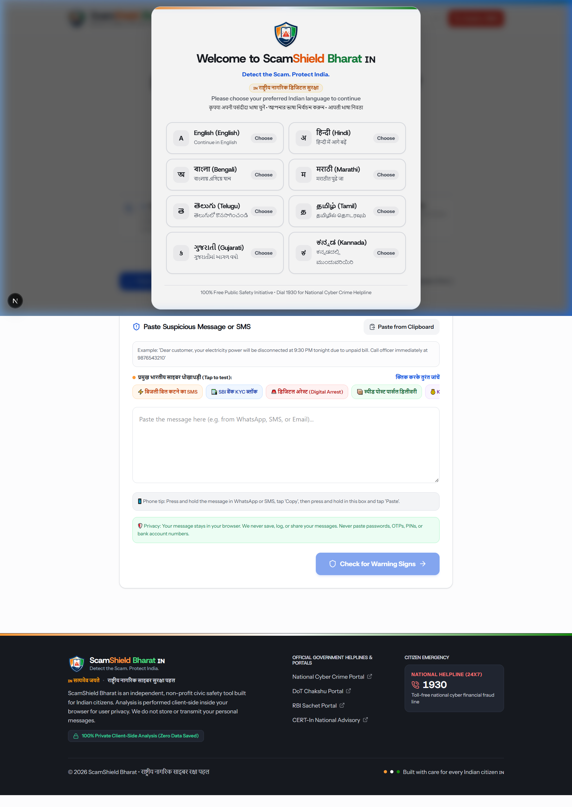
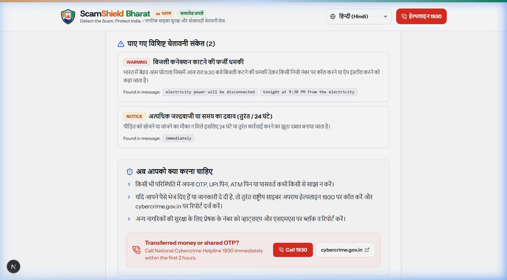
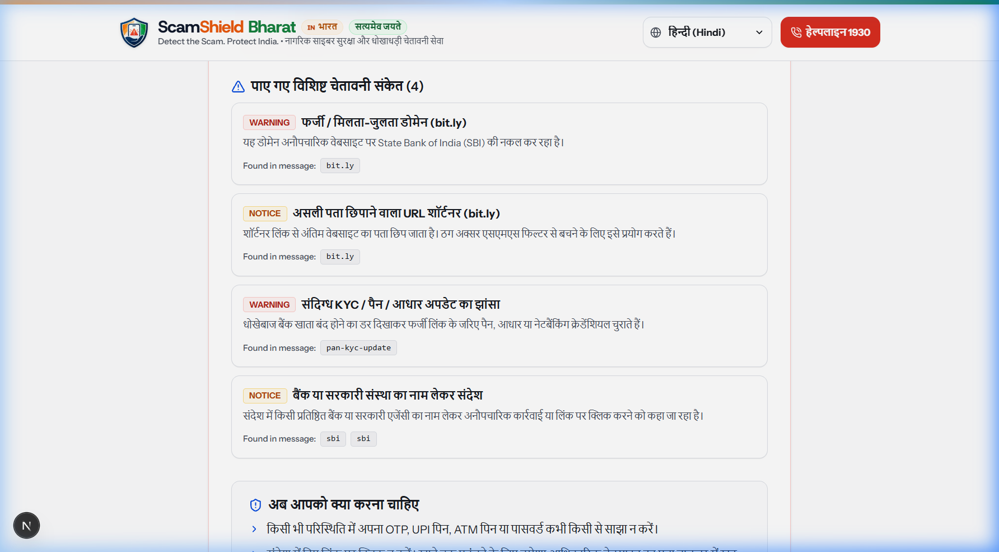

<p align="center">
  
</p>

<h1 align="center">ScamShield Bharat 🇮🇳</h1>

<p align="center">
  <strong>Detect the Scam. Protect India.</strong><br>
  <em>नागरिक साइबर सुरक्षा एवं धोखाधड़ी चेतावनी सेवा • Civic Cyber Defense & Scam Detection Platform</em>
</p>

<p align="center">
  <a href="https://nextjs.org/"></a>
  <a href="https://www.typescriptlang.org/"></a>
  <a href="https://tailwindcss.com/"></a>
  <a href="tel:1930"></a>
  <a href="#-security--privacy-guarantees"></a>
  <a href="#-multilingual-support"></a>
</p>

---

## 📌 Table of Contents

1. [Overview & Civic Mission](#-overview--civic-mission)
2. [Visual Walkthrough & Screenshots](#-visual-walkthrough--screenshots)
3. [Key Capabilities](#-key-capabilities)
   - [A. Multilingual Scam Analyzer](#a-multilingual-scam-analyzer)
   - [B. Deep URL & Domain Inspector](#b-deep-url--domain-inspector)
   - [C. Interactive 1930 Emergency Action Center](#c-interactive-1930-emergency-action-center)
   - [D. Realistic Indian Scam Test Scenarios](#d-realistic-indian-scam-test-scenarios)
4. [8 Major Indian Languages](#-8-major-indian-languages)
5. [Citizen-First & Accessible Design](#-citizen-first--accessible-design)
6. [Detection Engine & Threat Indicators](#-detection-engine--threat-indicators)
7. [System Architecture](#-system-architecture)
8. [Installation & Local Setup](#-installation--local-setup)
9. [Official Government Cybercrime Portals](#-official-government-cybercrime-portals)
10. [Security & Privacy Guarantees](#-security--privacy-guarantees)

---

## 🛡️ Overview & Civic Mission

India is experiencing exponential digital expansion, with over 800 million smartphone users and billions of monthly UPI transactions. However, this growth has brought an unprecedented wave of digital fraud targeting senior citizens, first-time smartphone users, and vernacular language speakers:

- **Fake Bank KYC Suspension Alerts**: Fraudulent SMS claiming SBI, PNB, or HDFC accounts are blocked, pushing victims to malicious shortlinks.
- **Electricity Disconnection Threats**: Urgent evening SMS claiming *"Power will be cut off tonight at 9:30 PM due to unpaid bills"*.
- **"Digital Arrest" Extortion**: Impersonators posing as Mumbai Police, CBI, or ED threatening victims over video calls.
- **Part-Time Work-From-Home Schemes**: Telegram traps promising daily payouts for liking YouTube videos.
- **Parcel Delivery & Speed Post Phishing**: Deceptive SMS with `.top` links claiming an address update is required.

**ScamShield Bharat** is an independent, non-profit civic cyber defense platform built specifically for Indian citizens. It provides instant, transparent, and explainable safety analysis for suspicious messages and links **100% inside your browser** without collecting passwords, personal data, or phone numbers.

---

## 📸 Visual Walkthrough & Screenshots

### 1. Hero Overview & Civic Branding
> The platform greets citizens with authoritative civic styling, national Tiranga accents, the official **"Detect the Scam. Protect India."** logo, emergency 1930 access, and real-time scam quick chips.

<p align="center">
  
</p>

---

### 2. Session Language Selection Modal (8 Indian Languages)
> Upon entering every new session, citizens are welcomed with an inclusive language selector offering native script glyphs for 8 major Indian languages.

<p align="center">
  
</p>

---

### 3. Transparent & Explainable Safety Assessment Dashboard
> No opaque scores or black boxes. The analyzer breaks down specific detected fraud patterns, risk levels (Low, Medium, High, Critical), step-by-step guidance, audio voice readout, and 1-click WhatsApp sharing for family protection.

<p align="center">
  
</p>

---

### 4. Deep URL & Domain Inspector
> Analyzes web links for brand typosquatting, high-abuse extensions (`.top`, `.xyz`, `.buzz`), dangerous APK downloads, and masks, while teaching citizens official Indian `.gov.in` and `.nic.in` domain security standards.

<p align="center">
  
</p>

---

## ⚡ Key Capabilities

### A. Multilingual Scam Analyzer
- **Direct Paste & Quick Test**: 1-click paste from clipboard or test against common fraud types with pre-loaded quick chips (⚡ बिजली बिल, 🏦 SBI KYC, 🚨 डिजिटल अरेस्ट, 📦 स्पीड पोस्ट, 💰 KBC लॉटरी).
- **Explainable Threat Indicators**: Clearly highlights artificial urgency, authority impersonation, financial traps, OTP theft, and remote access trojans.
- **Audio Readout (Text-to-Speech)**: Synthesizes spoken safety advice in the citizen's preferred language for senior citizens and low-literacy users.
- **Family WhatsApp Sharing**: Pre-formatted WhatsApp share link to allow citizens to instantly warn elderly parents or family members about a suspicious message.

### B. Deep URL & Domain Inspector
- **Brand Impersonation Detection**: Flags fake bank names and services (e.g. `sbi-kyc-update.com`, `yono-login.net`).
- **Dangerous Extensions & APKs**: Identifies `.apk`, `.exe`, `.top`, `.xyz`, `.buzz`, `.club` downloads.
- **Indian Domain Rules**: Explains that genuine Government of India websites always end in `.gov.in` or `.nic.in`.

### C. Interactive 1930 Emergency Action Center
- **The Golden Hours**: Highlights the critical 1–2 hour window to freeze stolen funds via the **National Cyber Crime Helpline (1930)**.
- **Incident Triage Wizard**: Step-by-step instructions for:
  1. *I already lost money / transferred via UPI*
  2. *I shared an OTP, PIN, or netbanking password*
  3. *Someone threatened me with "Digital Arrest"*
  4. *I clicked a suspicious link or downloaded an APK*

### D. Realistic Indian Scam Test Scenarios
Pre-loaded authentic Indian cybercrime cases for community awareness and live testing:
1. **Fake Bank KYC Suspension SMS** (`CRITICAL`)
2. **Electricity Disconnection Threat** (`HIGH`)
3. **KBC / Jio ₹25 Lakh Lottery Fraud** (`CRITICAL`)
4. **Work-from-Home YouTube Like Task Scam** (`HIGH`)
5. **India Post Parcel Delivery Phishing** (`HIGH`)
6. **Digital Arrest Police / CBI Extortion** (`CRITICAL`)
7. **Legitimate Bank Transaction Alert** (`LOW / SAFE`)

---

## 🇮🇳 8 Major Indian Languages

ScamShield Bharat is localized into 8 of the most widely spoken languages across India, complete with native fonts, translations, and text-to-speech audio:

| Language | Native Name | Script Glyph | Status |
| :--- | :--- | :---: | :---: |
| **English** | English | **A** | Full Support |
| **Hindi** | हिन्दी | **अ** | Full Support |
| **Bengali** | বাংলা | **অ** | Full Support |
| **Marathi** | मराठी | **म** | Full Support |
| **Telugu** | తెలుగు | **తె** | Full Support |
| **Tamil** | தமிழ் | **த** | Full Support |
| **Gujarati** | ગુજરાતી | **ક** | Full Support |
| **Kannada** | ಕನ್ನಡ | **ಕ** | Full Support |

---

## ♿ Citizen-First & Accessible Design

- **Touch Ergonomics (WCAG 2.5.5 / 2.5.8)**: Minimum 44px–48px touch targets on all interactive controls for effortless one-handed thumb navigation.
- **iOS Safari Auto-Zoom Prevention**: Enforces 16px font sizing on mobile inputs and textareas to eliminate disorienting viewport zoom.
- **High-Contrast Readability (WCAG AAA)**: High-contrast typography pairing Host Grotesk with Instrument Sans.
- **Zero Fake Data**: Strictly zero invented statistics, fake user reviews, or artificial claims—engineered exclusively as an honest civic public service.

---

## 🏗️ System Architecture

```
ScamShield Bharat/
├── docs/
│   └── screenshots/          # High-resolution documentation screenshots
│       ├── hero-overview.png
│       ├── language-modal.png
│       ├── analysis-result.png
│       └── url-checker.png
├── public/
│   ├── logo.png              # Official full logo lockup
│   ├── logo-icon.png         # Transparent shield emblem
│   └── favicon.ico
├── src/
│   ├── app/
│   │   ├── api/analyze/      # REST API endpoint for backend analysis
│   │   ├── globals.css       # Design tokens, mobile touch rules, safe insets
│   │   ├── layout.tsx        # Viewport, metadata, font imports
│   │   └── page.tsx          # Single-page citizen experience with tabs
│   ├── components/
│   │   ├── ActionCenter.tsx  # 1930 helpline & incident triage
│   │   ├── BrandLogo.tsx     # Reusable responsive logo component
│   │   ├── ExampleScenarios.tsx # Test cases
│   │   ├── Footer.tsx        # Civic links, CERT-In, I4C linkages
│   │   ├── HeroBanner.tsx    # Civic hero, motto, guidance steps
│   │   ├── LanguageSelectionModal.tsx # 8-language entry dialog
│   │   ├── Navbar.tsx        # Tiranga ribbon, logo, 1930 CTA
│   │   ├── ResultDashboard.tsx # Safety assessment result card
│   │   └── UrlSafetyChecker.tsx # Domain structure inspector
│   └── lib/
│       ├── data/examples.ts  # Authentic test cases
│       ├── engine/           # Local heuristics & regex rules
│       └── i18n/             # 8 Indian languages translation dictionaries
├── DESIGN.md                 # Design system specifications
└── README.md
```

---

## 💻 Installation & Local Setup

### Prerequisites
- **Node.js**: v18.18.0 or later
- **npm** or **pnpm** / **yarn**

### 1. Clone the Repository
```bash
git clone https://github.com/VG31OP/ScamShield-Bharat.git
cd ScamShield-Bharat
```

### 2. Install Dependencies
```bash
npm install
```

### 3. Run Development Server
```bash
npm run dev
```

Open [http://localhost:3000](http://localhost:3000) in your browser to view the application.

### 4. Build for Production
```bash
npm run build
npm run start
```

---

## 🏛️ Official Government Cybercrime Portals

If you or someone you know has been scammed, immediately contact official authorities:

- 🚨 **National Cyber Crime Helpline**: Dial **1930** (24x7 Toll-Free)
- 🌐 **National Cyber Crime Reporting Portal**: [cybercrime.gov.in](https://cybercrime.gov.in/)
- 📱 **DoT Sanchar Saathi (Chakshu - Report Suspicious SMS/Calls)**: [sancharsaathi.gov.in](https://sancharsaathi.gov.in/)
- 🏦 **RBI Sachet (Financial Fraud & Illegal Schemes)**: [sachet.rbi.org.in](https://sachet.rbi.org.in/)
- 🔒 **CERT-In (Indian Computer Emergency Response Team)**: [cert-in.org.in](https://www.cert-in.org.in/)

---

## 🔒 Security & Privacy Guarantees

1. **Client-Side Execution**: All message heuristic analysis is executed locally inside the citizen's browser.
2. **Zero Message Logging**: Your messages, URLs, and clipboard contents are **never stored in a database or server log**.
3. **Never Share Secrets**: ScamShield Bharat explicitly advises citizens to never paste passwords, OTPs, UPI PINs, or confidential credentials.

---

<p align="center">
  <strong>ScamShield Bharat 🇮🇳</strong><br>
  <em>सत्यमेव जयते • Dedicated to the digital safety of every citizen of India.</em>
</p>
